<div align="center">


# NEXt

Penata muatan kendaraan di geladak kapal kargo dengan algoritma *local search*.

Tugas Besar 1 IF3070 Dasar Inteligensi Artifisial 2026/2027, Kelompok 17

[](https://www.python.org)
[](https://bun.sh)
[](https://www.typescriptlang.org)


[](https://www.conventionalcommits.org/en/v1.0.0/)

[Deskripsi](#deskripsi) · [Struktur Repositori](#struktur-repositori) · [Setup](#setup) · [Panduan Penggunaan](#panduan-penggunaan) · [Algoritma](#algoritma) · [Hasil Eksperimen](#hasil-eksperimen) · [Pembagian Tugas](#pembagian-tugas) · [Referensi](#referensi)

</div>

---

## Deskripsi

NEXt memilih kendaraan yang diangkut kapal kargo beserta posisi dan orientasinya di geladak (*grid* 2D) agar total `shipping_fee` maksimum. Setiap kendaraan punya dimensi, `shipping_fee`, `weight`, dan `eta`, dan solusi harus memenuhi tiga batasan:

1. Tidak ada dua kendaraan yang menempati sel yang sama.
2. Seluruh kendaraan berada di dalam geladak.
3. Total berat tidak melebihi kapasitas kapal.

Kendaraan boleh tidak diangkut. Masalah ini diselesaikan dengan *local search*: mulai dari susunan acak, lalu diperbaiki lewat tiga *move* kecil, yaitu menukar dua kendaraan, memindahkan satu kendaraan, dan memutar orientasinya. Setiap *state* yang dihasilkan selalu valid.

### Cakupan

- Enam algoritma yang mengacu pada AIMA edisi ke-4 [[1]](#referensi): `steepest-ascent`, `sideways-move`, `stochastic`, `random-restart`, `simulated-annealing`, dan `genetic-algorithm`.
- Dua *objective*: `total-shipping-fee` (*default*) dan `urgency-weighted-fee`.
- Setiap konfigurasi dijalankan 3 kali, dan *genetic algorithm* divariasikan pada jumlah generasi dan ukuran populasi (total 33 *run*, hasilnya di [`output/final`](output/final)).
- *Viewer* web untuk menelusuri hasil langkah demi langkah.
- Multi-kapal tidak diimplementasikan.

---

## Struktur Repositori

```
.
├── src/
│   ├── core/           model, geometri, constraint, objective, neighbor, state awal
│   ├── algorithms/     hill-climbing (4 varian), simulated annealing, genetic algorithm
│   ├── experiments/    runner dan konfigurasi eksperimen
│   ├── storage/        baca dan buat instance, kontrak JSON, penulisan hasil
│   ├── instances/      instance masalah (default.json)
│   └── cli.py          entry point: python -m src.cli
├── frontend/           viewer web (Bun + TypeScript)
├── output/
│   ├── final/          hasil eksperimen
│   └── scratch/        hasil percobaan (diabaikan git)
├── docs/               laporan (PDF)
└── assets/             logo
```

---

## Setup

1. Pasang *prerequisites* berikut:
   - [Git](https://git-scm.com/downloads)
   - [Python](https://www.python.org/downloads/) 3.12 atau lebih baru
   - [Bun](https://bun.sh/docs/installation), untuk menjalankan *viewer* web

2. *Clone* repositori, lalu masuk ke foldernya:

   ```bash
   git clone https://github.com/ZulfaNurhuda/IF3070_G17_NEXt.git
   cd IF3070_G17_NEXt
   ```

---

## Panduan Penggunaan

> [!NOTE]
> **TL;DR**
>
> ```bash
> # Jalankan satu algoritma: 3 run dengan seed 1, 2, 3
> python -m src.cli run --algorithm steepest-ascent
>
> # Ganti parameter algoritma
> python -m src.cli run --algorithm genetic-algorithm --param population_size=30 --param generations=80
>
> # Jalankan semua konfigurasi eksperimen (33 run) ke output/final
> python -m src.cli run-all
>
> # Buat instance baru, lalu jalankan algoritma di atasnya
> python -m src.cli generate --name besar --vehicles 40 --ship-width 15 --ship-length 30
> python -m src.cli run --algorithm steepest-ascent --instance src/instances/besar.json
>
> # Lihat hasil di browser: http://localhost:3000
> bun run frontend/server.ts
> ```

### Detail

Semua perintah dijalankan dari *root* repositori. Cara membaca format perintah: `[ ]` berarti opsional, `|` berarti pilih salah satu, `...` berarti boleh diulang, dan HURUF_BESAR diganti dengan nilai yang diinginkan.

| Perintah | Fungsi | Menulis ke |
|---|---|---|
| [`run`](#perintah-run) | menjalankan satu algoritma | `output/scratch/` atau `output/final/` |
| [`run-all`](#perintah-run-all) | menjalankan semua konfigurasi eksperimen | `output/final/` |
| [`generate`](#perintah-generate) | membuat *instance* masalah baru | `src/instances/` |
| [`server.ts`](#viewer-web) | menjalankan *viewer* web | - |

#### Perintah `run`

Menjalankan satu algoritma dengan satu konfigurasi sebanyak `--runs` kali, lalu menulis satu berkas JSON berisi seluruh *run* dan mencetak *path*-nya.

```
python -m src.cli run --algorithm ALGORITMA [--param NAMA=NILAI]... [--runs RUNS]
                      [--seed SEED] [--instance INSTANCE] [--objective OBJECTIVE] [--out OUT]
```

| Opsi | Nilai | *Default* | Keterangan |
|---|---|---|---|
| `--algorithm ALGORITMA` | `steepest-ascent`, `sideways-move`, `stochastic`, `random-restart`, `simulated-annealing`, `genetic-algorithm` | wajib | algoritma yang dijalankan |
| `--param NAMA=NILAI` | lihat [parameter algoritma](#parameter-algoritma) | nilai *default* algoritma | mengganti satu parameter. Boleh diulang |
| `--runs RUNS` | bilangan bulat >= 1 | `3` | jumlah *run* |
| `--seed SEED` | `N` atau `RENDAH:TINGGI` | `0` | *seed* dasar, lihat [*seed*](#seed) |
| `--instance INSTANCE` | *path* berkas *instance* JSON | `src/instances/default.json` | masalah yang diselesaikan |
| `--objective OBJECTIVE` | `total-shipping-fee`, `urgency-weighted-fee` | `total-shipping-fee` | fungsi yang dimaksimalkan. `urgency-weighted-fee` = jumlah `shipping_fee / eta` kendaraan yang diangkut |
| `--out OUT` | `scratch`, `final` | `scratch` | folder hasil di bawah `output/` |

Contoh:

```bash
python -m src.cli run --algorithm sideways-move --param max_sideways=50
python -m src.cli run --algorithm random-restart --param inner=stochastic --param max_restart=5
python -m src.cli run --algorithm simulated-annealing --param max_iterations=5000 --param cooling_rate=0.999
python -m src.cli run --algorithm steepest-ascent --objective urgency-weighted-fee --seed 100:200
```

##### Parameter algoritma

`--param` berupa pasangan *key-value* `NAMA=NILAI`, dan nilainya dikonversi ke `int` atau `float` sesuai tipe parameternya. Nama yang tidak dikenal, pasangan tanpa `=`, parameter yang diberikan dua kali, dan nilai di luar batas ditolak dengan pesan kesalahan.

| Algoritma | Parameter | *Default* | Batas |
|---|---|---|---|
| `steepest-ascent` | - | - | - |
| `stochastic` | - | - | - |
| `sideways-move` | `max_sideways` | `100` | bilangan bulat >= 0 |
| `random-restart` | `inner` | `steepest-ascent` | nama algoritma lain, dengan parameter *default*-nya |
| | `max_restart` | `10` | bilangan bulat >= 1 |
| `simulated-annealing` | `initial_temperature` | otomatis | `0 < minimum_temperature < initial_temperature` |
| | `minimum_temperature` | otomatis | idem |
| | `max_iterations` | `20000` | bilangan bulat >= 1 |
| | `cooling_rate` | otomatis | `0 < cooling_rate < 1` |
| | `stuck_patience` | `200` | bilangan bulat >= 1 |
| `genetic-algorithm` | `population_size` | `50` | bilangan bulat > 0 |
| | `generations` | `100` | bilangan bulat >= 0 |
| | `mutation_rate` | `0.3` | `0 <= mutation_rate <= 1` |
| | `elitism_count` | `2` | `0 <= elitism_count <= population_size` |

Nilai "otomatis" dihitung di awal `run`, dan nilai yang dipakai dicatat di berkas hasil. Rumusnya ada di [*simulated annealing*](#simulated-annealing).

##### Seed

`--seed` adalah *seed* dasar. *Run* ke-*k* memakai *seed* dasar + *k*, jadi `--seed 0 --runs 3` memakai *seed* 1, 2, dan 3. *Seed* yang sama dengan opsi yang sama menghasilkan hasil yang sama.

| Bentuk | Artinya |
|---|---|
| `--seed 7` | *seed* dasar tepat 7 |
| `--seed 100:200` | dipilih acak dari 100 sampai 200, kedua ujung termasuk |
| `--seed 0:inf` | dipilih acak dari 0 sampai 2.147.483.647 |

*Seed* yang dipilih acak dicetak agar bisa diulang: `Seed dipakai: 143 (ulangi dengan --seed 143)`.

#### Perintah `run-all`

Menjalankan semua konfigurasi di bawah, masing-masing 3 *run*, ke `output/final/`. Berkas ditulis begitu konfigurasinya selesai, dengan *progress* `[k/11]`. Seluruh proses memakan waktu sekitar satu menit.

```
python -m src.cli run-all [--instance INSTANCE] [--objective OBJECTIVE] [--seed SEED]
```

Opsi `--instance`, `--objective`, dan `--seed` sama seperti pada `run`.

| No | Algoritma | Parameter |
|---|---|---|
| 1 | `steepest-ascent` | *default* |
| 2 | `sideways-move` | `max_sideways=100` |
| 3 | `stochastic` | *default* |
| 4 | `random-restart` | `inner=steepest-ascent`, `max_restart=10` |
| 5 | `simulated-annealing` | *default* |
| 6 | `genetic-algorithm` | `population_size=50`, `generations=50` |
| 7 | `genetic-algorithm` | `population_size=50`, `generations=100` |
| 8 | `genetic-algorithm` | `population_size=50`, `generations=200` |
| 9 | `genetic-algorithm` | `population_size=20`, `generations=150` |
| 10 | `genetic-algorithm` | `population_size=50`, `generations=150` |
| 11 | `genetic-algorithm` | `population_size=100`, `generations=150` |

#### Perintah `generate`

Membuat *instance* baru di `src/instances/NAME.json`. Perintah ini tidak menjalankan algoritma dan tidak pernah menimpa berkas yang sudah ada. Setelah selesai, nilai yang terpilih dicetak beserta contoh perintah untuk memakainya.

```
python -m src.cli generate --name NAME [--seed SEED] [--ship-width RENTANG] [--ship-length RENTANG]
                           [--capacity RENTANG | --capacity-ratio CAPACITY_RATIO]
                           [--vehicles RENTANG] [--vehicle-width RENTANG] [--vehicle-length RENTANG]
                           [--vehicle-shipping-fee RENTANG] [--vehicle-weight RENTANG]
                           [--vehicle-eta RENTANG] [--vehicle NAMA=NILAI,...]...
```

| Opsi | *Default* | Keterangan |
|---|---|---|
| `--name NAME` | wajib | nama berkas tanpa `.json`; hanya huruf, angka, `-`, dan `_` |
| `--seed SEED` | `0` | sama seperti pada `run` |
| `--ship-width RENTANG` | `10` | lebar geladak |
| `--ship-length RENTANG` | `20` | panjang geladak |
| `--capacity RENTANG` | - | kapasitas berat |
| `--capacity-ratio CAPACITY_RATIO` | `0.6` | kapasitas = pembulatan (rasio x total berat kendaraan), minimal 1. Tidak boleh bersamaan dengan `--capacity` |
| `--vehicles RENTANG` | jumlah `--vehicle`, atau 25 bila tidak ada | jumlah **total** kendaraan, termasuk yang ditulis lewat `--vehicle` |
| `--vehicle-width RENTANG` | `1:4` | lebar kendaraan acak |
| `--vehicle-length RENTANG` | `2:6` | panjang kendaraan acak |
| `--vehicle-shipping-fee RENTANG` | `20:100` | `shipping_fee` kendaraan acak |
| `--vehicle-weight RENTANG` | `2:8` | berat kendaraan acak |
| `--vehicle-eta RENTANG` | `1:10` | `eta` kendaraan acak |
| `--vehicle NAMA=NILAI,...` | - | satu kendaraan spesifik. Boleh diulang |

**RENTANG** adalah nilai yang bisa ditulis dalam dua bentuk:

- `N`: nilai tetap. `--ship-width 15` berarti lebar geladak 15.
- `RENDAH:TINGGI`: angka acak di antara RENDAH dan TINGGI, keduanya ikut dihitung. `--ship-width 10:20` berarti lebar geladak diacak antara 10 dan 20.

Angkanya berupa bilangan bulat minimal 1 (untuk `--seed`, minimal 0). Khusus `--seed`, TINGGI boleh ditulis `inf`, misalnya `--seed 0:inf`.

**`--vehicle`** menulis satu kendaraan dengan pasangan *key-value* yang dipisah koma, misalnya `id=10,width=4,length=8`. *Key* yang sah: `id`, `width`, `length`, `shipping_fee`, `weight`, dan `eta`.

- `id` berupa satu nomor. Kendaraan diberi nama `Car` diikuti nomor dua digit (`id=3` menjadi `Car03`), dan kendaraan tanpa `id` mengisi nomor kosong terkecil.
- Atribut yang tidak ditulis diisi acak. Prioritas per atribut: nilai di `--vehicle`, lalu `--vehicle-*`, lalu rentang *default*.

Perintah menolak permintaan yang mungkin menghasilkan *instance* mustahil, dengan memeriksa kasus terburuk: kendaraan terbesar harus muat di geladak terkecil (dalam orientasi mana pun), berat maksimum kendaraan tidak boleh melebihi kapasitas terkecil, batas bawah `--vehicles` tidak boleh lebih kecil dari jumlah `--vehicle`, dan `id` pada `--vehicle` tidak boleh kembar.

```bash
python -m src.cli generate --name acak --seed 0:inf --ship-width 10:20 --vehicles 8:30
python -m src.cli generate --name campuran --vehicles 12 --vehicle id=10,width=4,length=8 --vehicle id=3,width=2,length=5
```

#### Viewer web

```
bun run frontend/server.ts
```

Server membaca berkas JSON di `output/final/` dan `output/scratch/`, tidak menulis apa pun, dan hanya mendengarkan `127.0.0.1`.

| Variabel lingkungan | *Default* | Keterangan |
|---|---|---|
| `PORT` | `3000` | port server |

Buka <http://localhost:3000>, pilih berkas hasil dan *run*, lalu telusuri langkahnya dengan tombol **Awal**, **Back**, **Next**, dan **Akhir**. Layar menampilkan *grid* kapal pada langkah itu, nilai *objective*, berat, perubahan, kendaraan yang di luar kapal, dan grafik nilai per iterasi.

---

## Algoritma

Notasi: `nilai(s)` adalah `problem.value(s)`, dan `ΔE = nilai(neighbor) - nilai(sekarang)`. *Neighbor* adalah *state* hasil satu *move* valid (putar, pindah, atau tukar).

### Steepest-ascent

```text
sekarang <- state_acak()
ulangi:
    terbaik <- neighbor dengan nilai tertinggi (jika sama: pilih acak)
    jika nilai(terbaik) <= nilai(sekarang): kembalikan sekarang
    sekarang <- terbaik
```

### Stochastic

```text
sekarang <- state_acak()
ulangi:
    uphill <- semua neighbor dengan nilai > nilai(sekarang)
    jika uphill kosong: kembalikan sekarang
    sekarang <- satu anggota uphill, dipilih acak seragam
```

### Sideways-move

```text
sekarang <- state_acak() ; sideways <- 0
ulangi:
    terbaik <- neighbor dengan nilai tertinggi (jika sama: pilih acak)
    jika nilai(terbaik) < nilai(sekarang): kembalikan sekarang
    jika nilai(terbaik) = nilai(sekarang):
        jika sideways >= max_sideways: kembalikan sekarang
        sideways <- sideways + 1
    selain itu: sideways <- 0
    sekarang <- terbaik
```

### Random-restart

```text
terbaik <- kosong
ulangi max_restart kali:
    hasil <- jalankan algoritma inner dari state_acak() yang baru
    jika terbaik kosong atau nilai(hasil) > nilai(terbaik): terbaik <- hasil
kembalikan terbaik
```

### Simulated annealing

```text
sekarang <- state_acak() ; T <- initial_temperature
ulangi sampai iterasi = max_iterations atau T < minimum_temperature:
    next <- satu neighbor acak dari sekarang
    ΔE   <- nilai(next) - nilai(sekarang)
    jika ΔE > 0 atau acak(0, 1) < e^(ΔE / T): sekarang <- next
    T <- cooling_rate x T
kembalikan sekarang
```

Parameter suhu yang tidak diberikan dihitung otomatis dari skala `s`, yaitu rata-rata besar penurunan nilai pada 100 *neighbor* acak dari *state* awal [[7]](#referensi):

- `initial_temperature = 2 x s`
- `minimum_temperature = 0,01 x s`
- `cooling_rate = (minimum_temperature / initial_temperature)^(1 / max_iterations)`

*Stuck* terjadi bila nilai *state* sekarang tidak berubah selama `stuck_patience` iterasi berturut-turut.

### Genetic algorithm

```text
populasi <- population_size state acak
ulangi generations kali:
    populasi_baru <- elitism_count individu terbaik dari populasi
    selama ukuran populasi_baru < population_size:
        a, b <- dua individu dari populasi (peluang sebanding nilai)
        anak <- crossover(a, b)
        jika acak(0, 1) < mutation_rate: anak <- satu neighbor acak dari anak
        tambahkan anak ke populasi_baru
    populasi <- populasi_baru
kembalikan individu terbaik dari populasi

crossover(a, b):
    c <- titik potong acak pada daftar kendaraan (urutan di instance)
    letak kendaraan sebelum c diambil dari a, sisanya dari b
    tempatkan satu per satu; letak yang bentrok atau tidak muat dilewati
```

Mutasi dan elitisme mengacu pada [[8]](#referensi).

## Hasil Eksperimen

Hasil 11 konfigurasi dengan 3 *run* per konfigurasi pada *instance default* (geladak 10 x 20, 25 kendaraan, kapasitas 72), *objective* `total-shipping-fee`, dan `--seed 0`, sehingga *run* 1, 2, 3 memakai *seed* 1, 2, 3. Nilai adalah total `shipping_fee` kendaraan yang diangkut pada *state* akhir. Gambar menampilkan *state* awal dan akhir *run* 1, dan berkas lengkapnya ada di [`output/final`](output/final).

| Konfigurasi | *Run* 1 | *Run* 2 | *Run* 3 | Rata-rata | Durasi (dtk) | Awal | Akhir |
|---|---:|---:|---:|---:|---:|:---:|:---:|
| `steepest-ascent` | 933 | 933 | 912 | 926,0 | 0,22 |  | 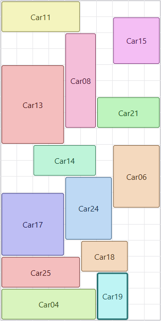 |
| `sideways-move`<br>`max_sideways=100` | 938 | 938 | 940 | **938,7** | 2,19 | 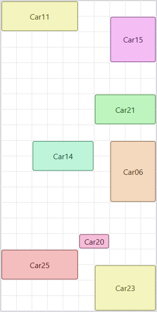 | 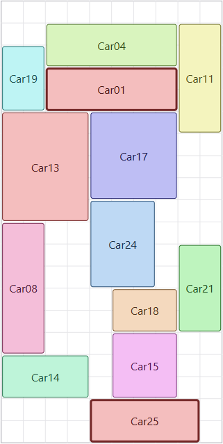 |
| `stochastic` | 902 | 916 | 906 | 908,0 | 0,39 |  | 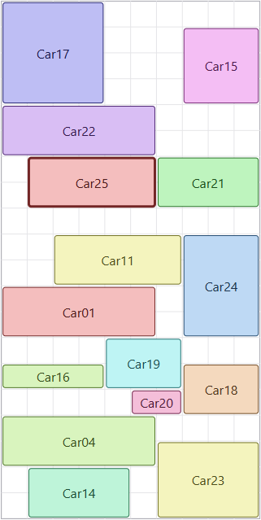 |
| `random-restart`<br>`max_restart=10` | 933 | 933 | 926 | 930,7 | 1,75 |  | 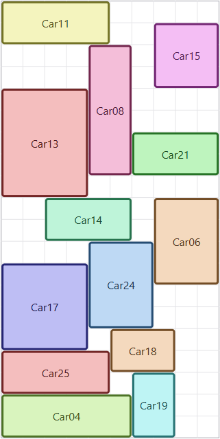 |
| `simulated-annealing` | 936 | 914 | 941 | 930,3 | 6,81 |  | 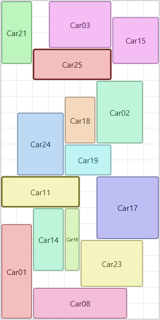 |
| `genetic-algorithm`<br>`population_size=50`<br>`generations=50` | 845 | 894 | 918 | 885,7 | 0,27 |  | 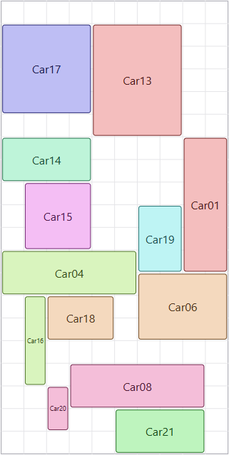 |
| `genetic-algorithm`<br>`population_size=50`<br>`generations=100` | 903 | 909 | 930 | 914,0 | 0,63 | 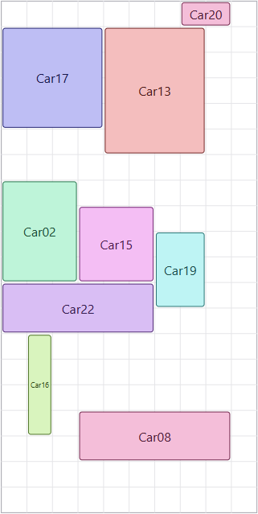 |  |
| `genetic-algorithm`<br>`population_size=50`<br>`generations=150` | 903 | 921 | 930 | 918,0 | 0,96 |  | 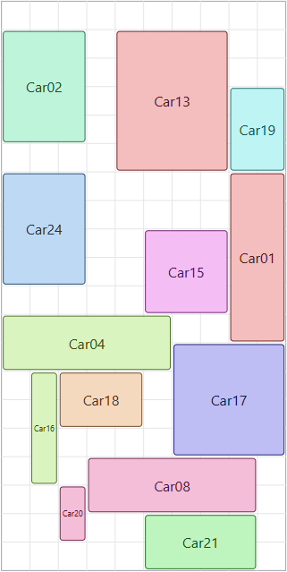 |
| `genetic-algorithm`<br>`population_size=50`<br>`generations=200` | 903 | 931 | 930 | 921,3 | 1,47 |  |  |
| `genetic-algorithm`<br>`population_size=20`<br>`generations=150` | 915 | 919 | 908 | 914,0 | 0,38 | 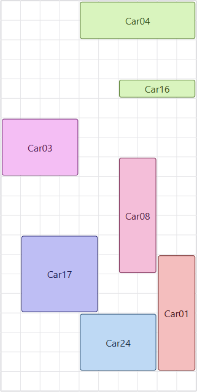 | 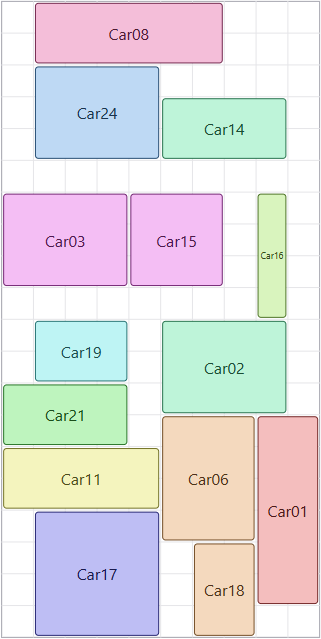 |
| `genetic-algorithm`<br>`population_size=100`<br>`generations=150` | 908 | 923 | 928 | 919,7 | 1,75 |  | 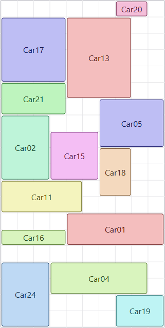 |

---

## Pembagian Tugas

| Anggota | NIM | GitHub | Tanggung jawab |
|---|---|---|---|
| Muhammad Zulfa Fauzan Nurhuda | 18224064 | [@ZulfaNurhuda](https://github.com/ZulfaNurhuda) | Setup repositori dan tooling, seluruh `core` awal (model domain, geometri, *constraint*, dua *objective*, *neighbor*, *state* awal, transisi, validasi, penempatan kendaraan), serialisasi (baca *instance*, konversi *state*/run ke JSON, *payload*, penulisan hasil), CLI `run` dan `run-all`, *runner* dan konfigurasi eksperimen, *viewer* web (server Bun, render geladak, timeline, panel info, grafik), optimasi performa menyeluruh di semua modul, refactor lintas *scope*, serta dokumentasi (README, logo, gambar hasil, sitasi algoritma). |
| Agung Ahmad Rifai | 18224042 | [@ag003ng](https://github.com/ag003ng) | Empat varian *hill-climbing* (`steepest-ascent`, `sideways-move`, `stochastic`, `random-restart`), *simulated annealing*, perbaikan kritis pada algoritma (kalibrasi suhu annealing, bobot *roulette* negatif, *replay* random restart), penamaan berkas hasil dari konfigurasi, *seed* berentang pada CLI, serta refactor modul storage, CLI, `core`, `algorithms`, dan frontend. |
| Bram Sebastian Pangaribuan | 18224076 | [@KimoonTheCreator](https://github.com/KimoonTheCreator) | *Genetic algorithm*, *instance default*, perintah `generate` (pembacaan rentang integer dan pembuatan *instance* dari spesifikasi), modularisasi frontend (data folder, view folder, pemisahan chart/info panel dan navigasi run), refactor pengelompokan algoritma ke dalam paket, refactor `core` (geometri, *move builders*, *sampling*, enumerasi), refactor serialize dan experiments, serta berbagai perbaikan frontend dan algoritma. |

---

## Referensi

1. S. Russell and P. Norvig, *Artificial Intelligence: A Modern Approach*, 4th ed. Hoboken, NJ, USA: Pearson, 2020, ch. 4, sec. 4.1.
2. M. L. Khodra, "Beyond Classical Search: Classical vs Local Search," YouTube, 2021. [Video]. Available: https://www.youtube.com/watch?v=oGTa9kGE3P8
3. M. L. Khodra, "Beyond Classical Search: State (Value, Neighbor)," YouTube, 2021. [Video]. Available: https://www.youtube.com/watch?v=_6rla37QorM
4. M. L. Khodra, "Beyond Classical Search: Hill-climbing Search," YouTube, 2021. [Video]. Available: https://www.youtube.com/watch?v=L0b0CN3Fds8
5. M. L. Khodra, "Beyond Classical Search: Simulated Annealing," YouTube, 2021. [Video]. Available: https://www.youtube.com/watch?v=AdhG7HnhYrk
6. M. L. Khodra, "Beyond Classical Search: Genetic Algorithm," YouTube, 2021. [Video]. Available: https://www.youtube.com/watch?v=aI41TGo9J9c
7. W. Ben-Ameur, "Computing the initial temperature of simulated annealing," *Comput. Optim. Appl.*, vol. 29, no. 3, pp. 369-385, Dec. 2004, doi: 10.1023/B:COAP.0000044187.23143.BD.
8. A. E. Eiben and J. E. Smith, *Introduction to Evolutionary Computing*, 2nd ed. Berlin, Germany: Springer, 2015, sec. 4.2.1 and 5.3.2.
